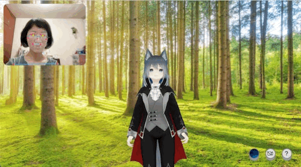

# VRM Motion Capture with MediaPipe

A browser-based engineering experiment exploring how webcam landmarks from MediaPipe Holistic can drive a VRM avatar through Kalidokit and Three.js.

> **Historical Investigation — 2023**
>
> This repository preserves a proof of concept built with the web technologies and library versions I was using at the time. It is maintained as an engineering experiment rather than a current production motion-capture system.

## Demo



Real-time webcam landmarks are processed with MediaPipe Holistic and Kalidokit to drive a VRM avatar rendered with Three.js.

## What I Investigated

**Can open-source browser-based motion capture provide enough information to animate an existing VRM avatar from webcam input?**

The experiment connects webcam capture, computer-vision landmarks, motion solving, avatar rigging, and browser rendering into a single client-side pipeline.

```text
Webcam
   ↓
MediaPipe Holistic
   ↓
Face / Pose / Hand Landmarks
   ↓
Kalidokit + Transformation Logic
   ↓
VRM Bones and Expressions
   ↓
Three.js Renderer
   ↓
Animated Avatar
```

## Why I Explored This

> **Author context**

At the time, I was working on avatar experiences at VIVERSE. With VTubers and virtual-avatar interaction becoming increasingly visible, we were exploring whether open-source technologies such as MediaPipe could extend existing avatar experiences with webcam-driven motion.

For the initial proof of concept, I considered the approach successful if the motion-capture pipeline could be reproduced with a browser-based stack compatible with the kind of avatar system we were working with.

Once the basic pipeline worked, I spent additional time refining arm, hand, and finger rigging to improve motion quality.

This public repository is a personal engineering experiment and should not be interpreted as VIVERSE's proprietary implementation.

## How It Works

MediaPipe Holistic processes webcam frames and returns landmark data for:

- face
- body pose
- left hand
- right hand

Kalidokit converts those landmarks into values that can be used for humanoid motion.

The implementation then applies those values to VRM humanoid bones and expressions before rendering the avatar through Three.js.

The repository includes handling for:

- hips, chest, and spine
- upper and lower arms
- upper and lower legs
- wrists
- individual finger joints
- neck rotation
- blink
- mouth expressions
- look-at behavior

It also renders landmark overlays over the webcam input so the detected motion can be visually compared with the resulting avatar movement.

## Motion and Coordinate Handling

Webcam landmarks and VRM bones do not naturally share the same coordinate conventions.

The implementation therefore includes explicit handling for:

- mirrored webcam input
- swapped left/right hand streams
- hip-axis adjustments
- VRM model orientation
- per-bone rotation adjustments

Motion is also smoothed using techniques including:

- quaternion interpolation (`slerp`)
- vector interpolation (`lerp`)
- expression interpolation
- pupil smoothing
- Kalidokit blink stabilization
- MediaPipe landmark smoothing

These adjustments help translate computer-vision output into more usable avatar movement.

## Technical Challenges

### Working with Limited Reference Implementations

> **Author context**

One of the hardest parts of the experiment was understanding how the available libraries and external examples fit together.

Some useful reference implementations contained minified files, which made the relevant runtime behavior difficult to inspect. I attempted to contact one of the developers for clarification but did not receive a response.

Instead, I relied on direct investigation: setting breakpoints, observing how files and values were loaded at runtime, comparing external implementations, and testing a newer MediaPipe library to see whether dependency changes affected the behavior.

This taught me how to continue developing a proof of concept when documentation and usable reference material are incomplete.

### Arms, Hands, and Fingers

> **Author observation**

Face, general body movement, and facial expressions worked reasonably well for the purposes of the proof of concept.

Arms and hands were more difficult.

The implementation eventually included explicit mappings for wrists and individual finger joints, along with additional rotation and smoothing logic, but this remained the area where further tuning would have been most useful.

## What I Learned

The main lesson was that the difficult part of combining open-source technologies is often not getting each library to run individually.

The harder engineering problem is understanding the boundaries between them:

```text
computer vision
→ coordinate interpretation
→ motion solving
→ avatar rigging
→ rendering
```

When documentation stops being sufficient, runtime inspection, experimentation, and careful parameter tuning become part of the engineering process.

The project also reinforced the value of treating a proof of concept as an investigation rather than trying to make it production-complete too early.

## Limitations

This repository demonstrates technical feasibility rather than production readiness.

It does **not** provide:

- formal latency or frame-rate benchmarks
- systematic accuracy measurements
- automated tests
- a browser/device compatibility matrix
- production performance guarantees

Tracking quality was also not formally evaluated across lighting conditions, occlusion, fast motion, or different hardware.

The repository therefore demonstrates the existence and implementation of the motion-capture pipeline, not measured motion-capture quality.

## Looking Back

If I revisited the experiment today, I would make the tuning process more systematic.

I would record parameter changes and compare their effects instead of relying primarily on visual inspection, especially for arms, hands, and fingers.

I would also preserve more of the debugging trail so that library-version changes, transformations, and rigging adjustments could be traced back to specific observed problems.

## Future Investigation

If I continued the experiment, I would focus on improving motion quality rather than expanding it into a larger application.

Areas I would explore include:

- further arm and finger rigging refinement
- systematic parameter comparison
- performance measurement
- testing additional VRM models
- avatar hair and accessory behavior during tracked motion

## Tech Stack

### Computer Vision

- MediaPipe Holistic `0.5.1635989137`

### Motion Solving

- Kalidokit `1.1.5`

### Avatar / Rendering

- Three.js `0.153.0`
- `@pixiv/three-vrm` `1.0.10`

### Frontend

- Next.js `12.3.4`
- React `18.2.0`
- TypeScript `5.1.3`
- Chakra UI `2.8.2`
- React Spring `9.7.3`
- Use Gesture `10.3.0`

## Run Locally

This project uses a Yarn v1 lockfile.

```bash
yarn install
yarn dev
```

Other available commands:

```bash
yarn build
yarn start
yarn lint
```

`yarn build` has been verified successfully with Yarn `1.22.22`.

No Node.js version is explicitly pinned in the repository.

The application requires browser camera permission to provide webcam input.

## Acknowledgements

This project builds on open-source tools and reference implementations from the avatar and motion-capture community.

Portions of the webcam-to-VRM rigging implementation in `src/components/KalidoCanvas.tsx` were adapted from the [Kalidokit Demo by YoonHwan (art1st)](https://codepen.io/art1st/pen/wvPoOKK) and informed by the [Kalidokit](https://github.com/yeemachine/kalidokit) project by yeemachine.

Kalidokit is distributed under the MIT License. The original project and its license should be consulted when reusing code derived from Kalidokit.

This project was bootstrapped with Create Next App.

### Avatar Assets

The VRM model currently included in `public/models/avatar.vrm` contains the following attribution metadata:

- **Creator:** `siroihakumai`
- **Model:** `26`
- **License metadata:** `Other`
- **Redistribution:** permitted according to the model's embedded VRoid Hub permission metadata

The avatar remains subject to its original creator's usage terms.

Historical versions of this experiment also used the Ashtra VRM model by `아기쥐작업소`. That model is not distributed with the current repository.

Third-party code and assets remain subject to their respective authors' licenses and usage terms.

## Related Investigation

While exploring Three.js and avatar rendering, I also investigated how physically based rendering (PBR) texture maps affect material appearance:

**[Experimenting with PBR Textures Using Three.js](https://medium.com/@Makoto_29712/experimenting-with-pbr-textures-usingthree-js-a25aad28ed65)**

The PBR investigation is related through the broader Three.js and avatar-rendering context, but it is separate from the MediaPipe motion-capture pipeline documented in this repository.

## Project Status

🔵 **Historical Investigation**

The core webcam → MediaPipe → Kalidokit → VRM → Three.js pipeline is complete as a proof of concept.

The repository is preserved as a record of the technical investigation rather than maintained as a current production motion-capture system.
